<<<<<<< HEAD
# v2i · 视频 → 文字 → 洞察

一条命令把公开视频变成三份 Markdown：**摘要卡**、**观点清单**、**可发布长文**。  
链路：`yt-dlp`（取字幕/音频）→ `faster-whisper`（CPU 转写）→ 大模型（map-reduce 提炼）。

```
URL ──► fetch（字幕优先） ──► transcribe（无字幕才跑） ──► normalize（分块+时间锚点）
                                                              │
                                     ┌────────────────────────┘
                                     ▼
                     map：每块 → 结构化笔记（要点/论据/引用/时间码）
                                     ▼
                     reduce：摘要卡 ｜ 观点清单 ｜ 长文
                                     ▼
                runs/<标题>-<id>/out/{summary,points,article}.md
```

## 安装（Windows，无需 GPU）

依赖装在项目内的 `vendor/`，不污染全局 Python。**镜像用阿里云**（清华源在本机 pip 26 上解析不到包，直接连 pypi 会被限速到 30KB/s）：

```powershell
$root = "D:\code\reasonix-ds-workspace\video2insight"
python -m pip install --target "$root\vendor" --upgrade `
  yt-dlp faster-whisper "av==16.1.0" requests imageio-ffmpeg `
  -i https://mirrors.aliyun.com/pypi/simple
```

> `av` 必须 < 19：av 19 去掉了 `metadata_errors` 参数，faster-whisper 1.2.1 会直接报 `TypeError`。

配置 key（二选一）：

1. **界面里配（推荐，立即生效）**：启动后左侧「系统配置」→ 填 API Key → 保存，不用重启；
2. 写进 `.env`：`DEEPSEEK_API_KEY=sk-...`（改完需要重启进程）。

```powershell
notepad "$root\.env"     # 也可以走文件
```

自检：

```powershell
cd $root
.\v2i.cmd doctor          # 依赖 / ffmpeg / CUDA / 运行目录 / key
.\v2i.cmd doctor --ping   # 顺带调一次大模型，验证 key 与网络
python tools\selftest.py  # 离线自检：字幕解析 / 分块 / JSON 抽取 / 引用校验
```

> 不用 `v2i.cmd` 时：`$env:PYTHONPATH="$root\vendor;$root"`，然后 `python -m v2i ...`。

## 用法

```powershell
# 全流程（默认产出 summary + points + article）
.\v2i.cmd run "https://www.bilibili.com/video/BV1GJ411x7h7"

# 只要摘要和观点
.\v2i.cmd run "<url>" --mode summary,points

# 有字幕也不用，强制转写（想要更高精度的中文）
.\v2i.cmd run "<url>" --no-subs --asr-model medium

# 批量
.\v2i.cmd batch urls.txt --mode all

# 只重跑提炼（换 prompt / 换模型，不重新转写）
.\v2i.cmd distill runs\<dir> --force

# 只重渲染 Markdown（改排版/改 frontmatter，不调用大模型、不花钱）
.\v2i.cmd render runs\<dir>

# 本地文件转写
.\v2i.cmd transcribe "D:\path\to\audio.mp3" --language zh
```

## 一键启动

**双击 `start.cmd`** 就行：缺依赖会自动装（阿里云源）、缺 `.env` 会自动建、起服务后自动开浏览器。

```
start.cmd          # 首次运行装依赖，之后直接开界面
v2i.cmd            # 不带参数双击 = 同一个效果；带参数 = 当 CLI 用
```

> 首次启动要下 250MB 依赖 + 之后首次转写要下 460MB 模型（`small`），都属于一次性成本。

## Web GUI（本地网页）

不想敲命令就用它，页面和 CLI 走的是同一条流水线：

```powershell
.\v2i.cmd web                          # 默认 http://127.0.0.1:8765，自动开浏览器
.\v2i.cmd web --port 8899 --no-browser
```


能做的事：

- **两种素材来源**：贴链接，或**把本地音频/视频拖进来**（mp3 / m4a / wav / mp4 / mkv …，最大 4GB）。
- **保留原视频**：新建任务页模式那排勾上「保留原视频」（和「文案」同一行，虚线标签），就会下载带画面的 mp4（默认 ≤720p），文件列表里标 `VIDEO`，点开直接在弹层里播放、也可下载；转写直接从 mp4 的音轨解，不用额外再下一份音频。
- **补下原视频**：老任务当初只下了音频也没关系——结果卡片右上角有「补下原视频」，点一下就在后台补下载并刷新文件列表，逐字稿和提炼产物都不动。
- **平台下拉 + 先探测**：13 个平台可选（B 站 / 抖音 / 快手 / 小红书 / 微博 / 西瓜 / YouTube / X / TikTok / Instagram / Vimeo / 播客…），贴链接会自动识别；点「先探测」不下载就能看到标题、时长、有没有字幕、多少个格式——失败也会直接告诉你缺 cookie 还是缺代理。
- **Cookies / 代理**：高级选项里可选用浏览器 cookies（Chrome / Edge / Firefox）或填代理地址，不必改 `.env`。
- **默认就开箱可用**：字幕优先 + `small` 模型，勾选要哪几份产物（摘要卡 / 观点清单 / 长文）直接开始；高级选项里可换模型、语言、强制重跑。
- **实时进度**：阶段（解析 → 下载 → 转写 → 提炼）、进度条、逐行日志（含 VAD 回退、转写百分比）。
- **产物阅读**：摘要 / 观点 / 长文 / **文案** / 逐字稿 / 字幕 / 结构化 JSON / 元数据，Markdown 渲染带时间码高亮；文案页有「复制全文」。
- **文案风格三档**：`原样`（只去时间码/口水词，不调模型）/ `轻度整理`（分段润色，保事实）/ `口播稿`（重排顺序、短句、加钩子），高级选项里切换。
- **所有文件 + 内嵌预览**：最后一个页签列出运行目录里全部文件（含 `source.m4a`）。点任意一行弹层预览——文本渲染 Markdown、JSON 美化、SRT 原样；图片直接显示；音频/视频用原生播放器（**支持 Range，可拖动进度**）；不能预览的直接下载。
- **历史**：左侧列出所有跑过的任务，点开即看；引用校验有问题的任务会标 `N 处引用待核`。
- **断线重连**：刷新页面会自动接上还在跑的任务；地址栏 `#run=<目录名>` 可直达某次结果。


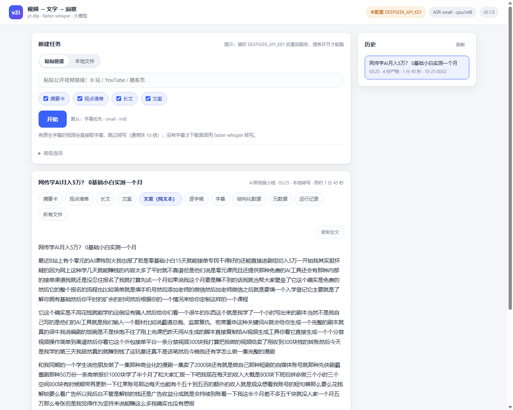

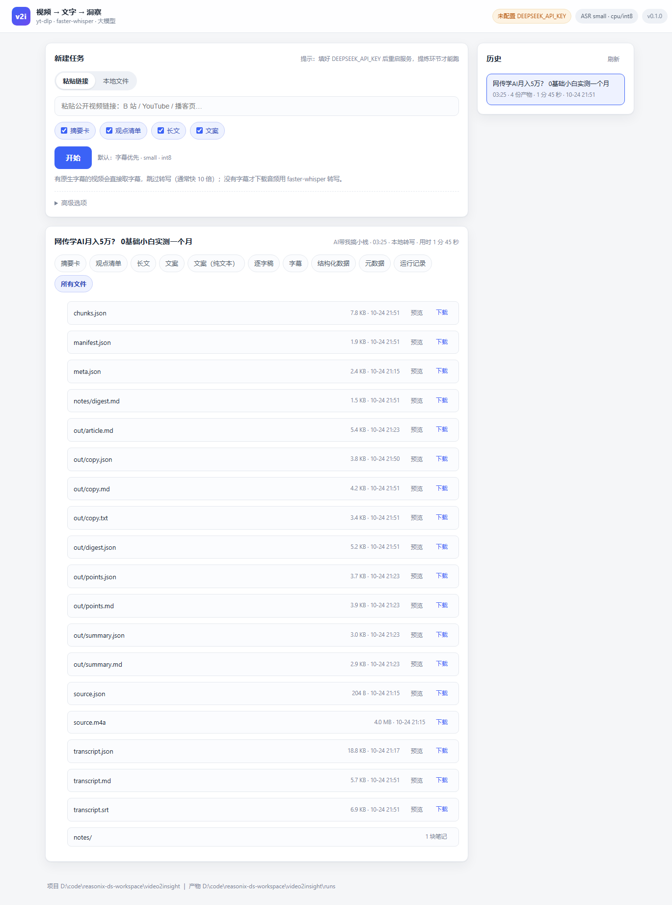

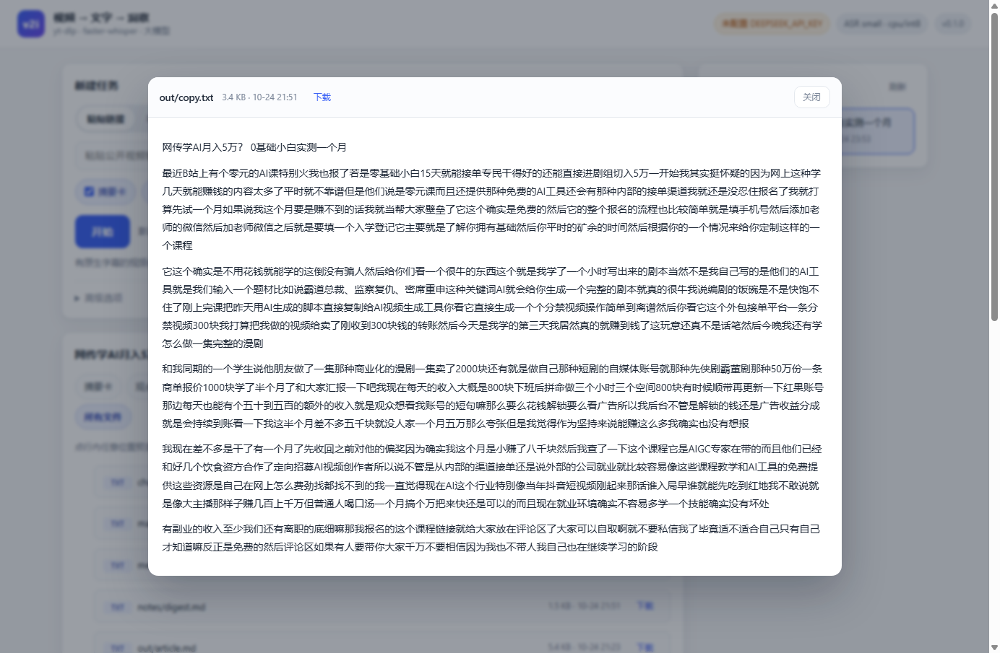

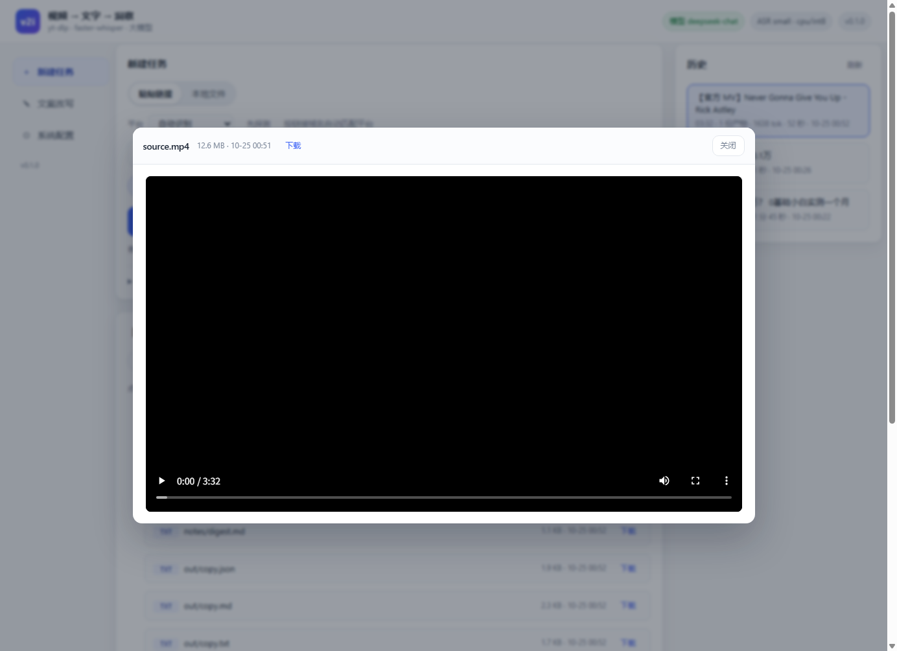

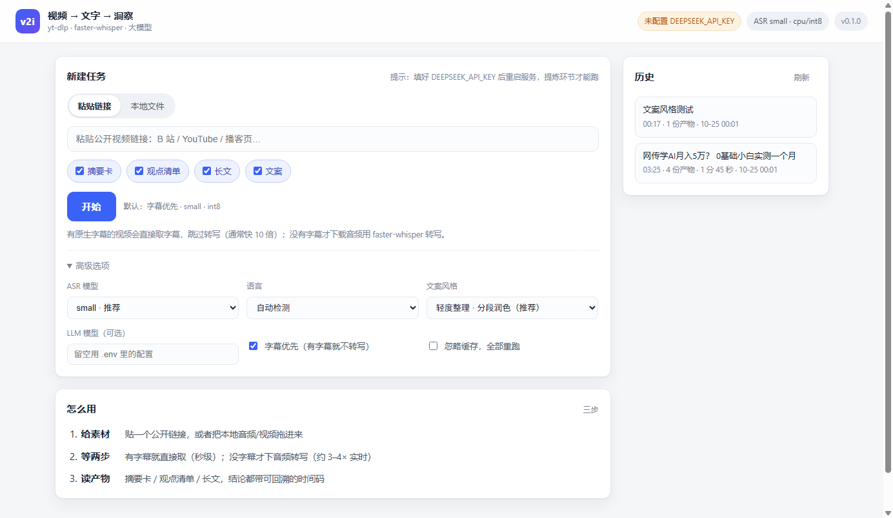

### 系统配置页 · 启动后改配置（热加载）

左侧「系统配置」可以在**不重启**的情况下改这些：

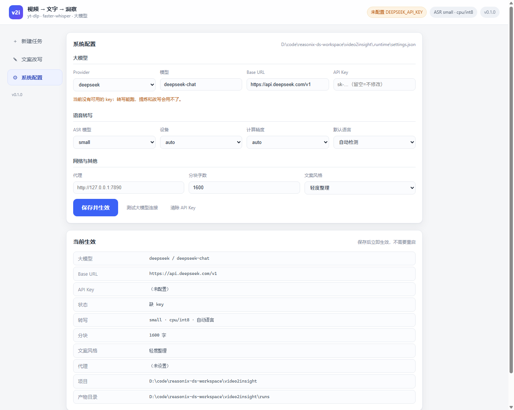

| 分组 | 项 |
|---|---|
| 大模型 | Provider、模型、Base URL、**API Key** |
| 语音转写 | ASR 模型（tiny→large-v3/turbo）、设备（auto/cpu/cuda）、精度（int8/float16）、默认语言 |
| 网络与其他 | 代理、分块字数、文案风格 |

- 保存后立即生效：状态点从「未配置」变绿，「提炼」「一键改写」马上能用，下一条任务就用新的 ASR 模型；
- **「测试大模型连接」**会真的发一次请求（回 `pong` 才算通），key 错直接告诉你 401；
- API Key 只显示 `sk-d…3456` 掩码，输入框留空表示不修改；「清除 API Key」回退到 `.env` / 环境变量；
- 配置写在 `.runtime/settings.json`（已 gitignore），优先级高于 `.env`；「当前生效」区显示的是**解析后的真实值**（如 `small · cpu/int8 · 自动语言`）。

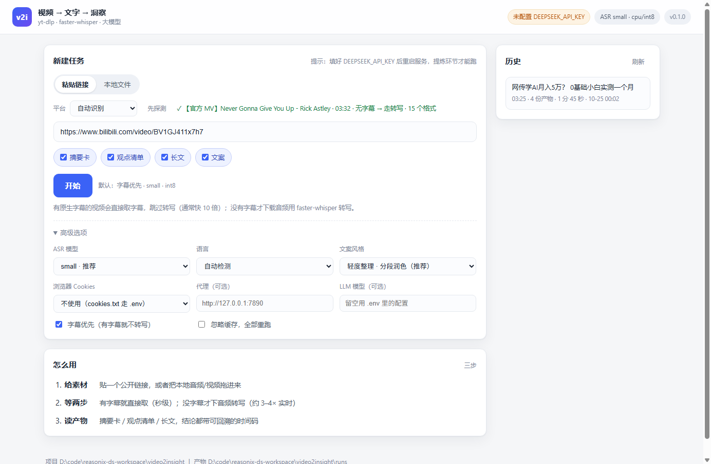

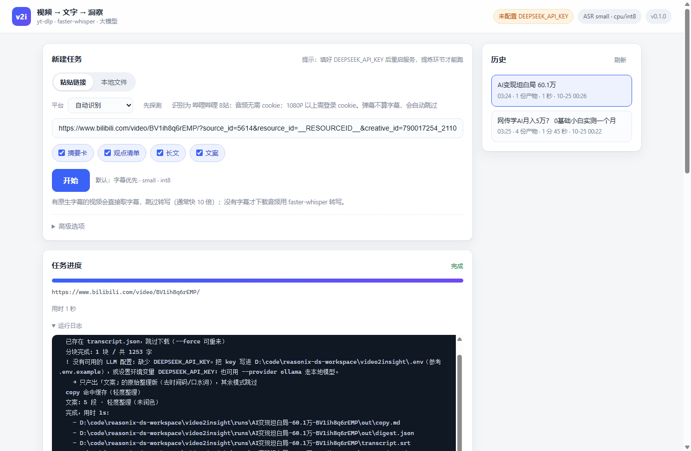

> 截图里的文案是接 mock 模型跑出来的（为了先验证链路），换成真实 key 后就是正常内容；界面、时间码、渲染是真的。

### 左侧菜单 · 文案改写

界面分两页：

| 页面 | 干什么 |
|---|---|
| **新建任务** | 就是上面的主页面：贴链接/传文件 → 转写 → 提炼 |
| **历史任务** | 全部任务按时间倒序列出，可搜索/只看有视频的，点一条就在下面展开详情 |
| **文案改写** | 粘一段文本（或从已有任务导入逐字稿）→ 选风格 → 一键改写 |
| **系统配置** | key / 模型 / ASR / 代理，改完立即生效 |

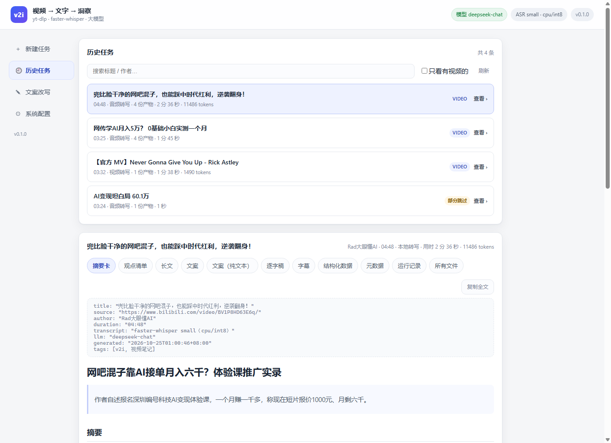

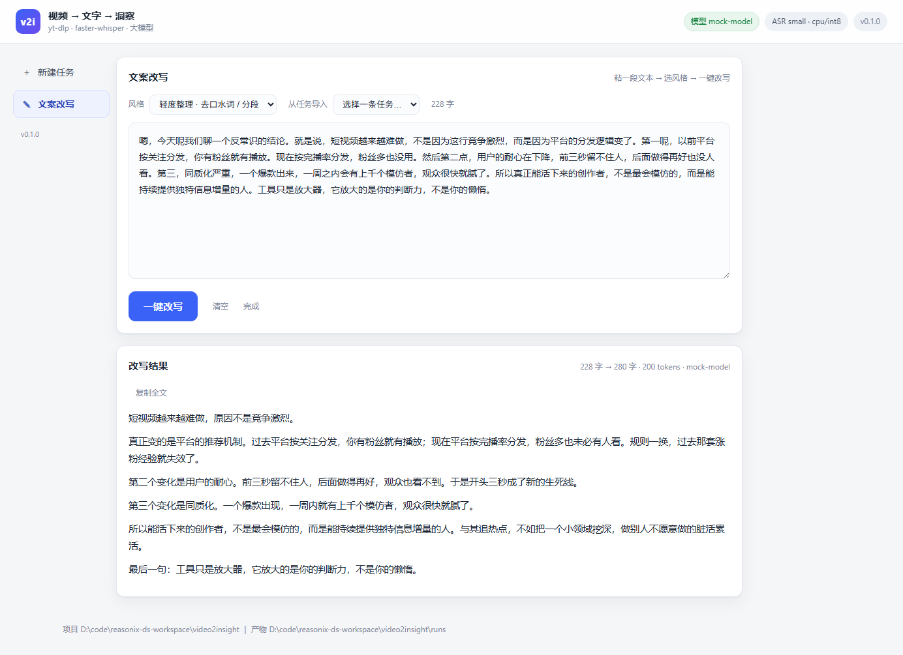

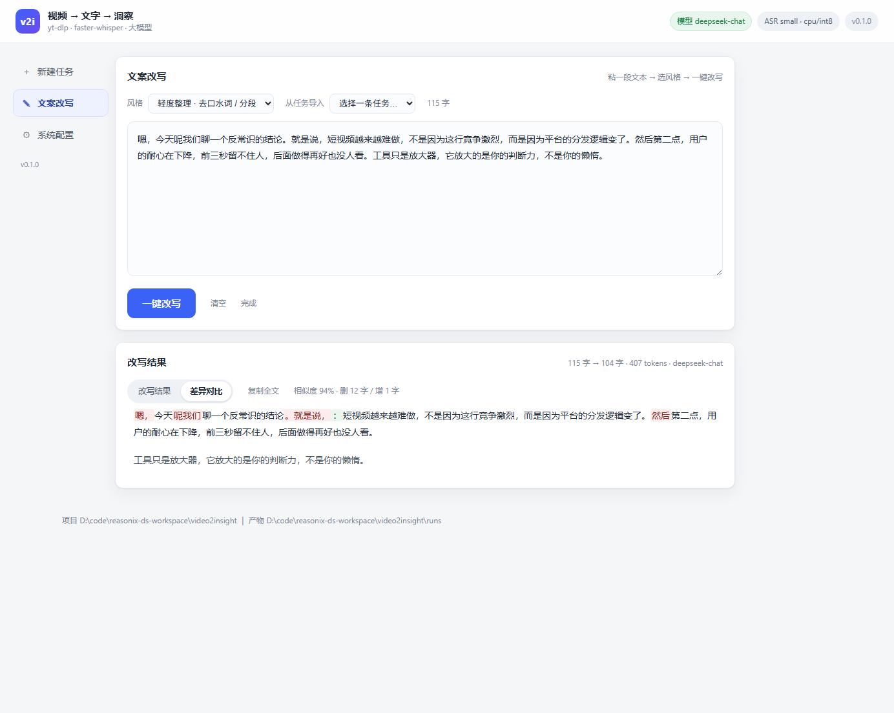

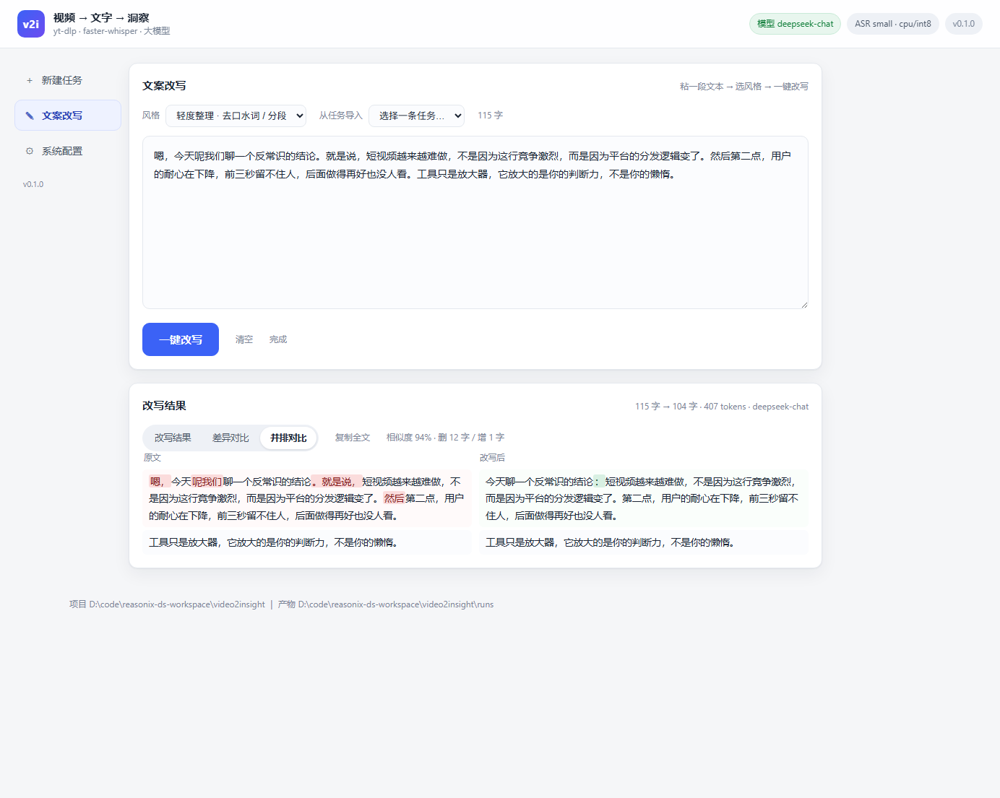

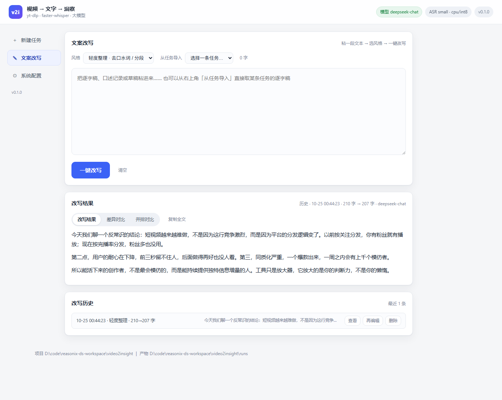

- **两种风格**：`轻度整理`（去口水词、分段、补断句）/ `口播稿`（短句、口语、开头钩子）；
- **从任务导入**：下拉列出所有带逐字稿的任务，选中后自动去掉时间码和元信息，直接填进输入框；
- **长文自动分段**：超过 6000 字按段落切片，逐段改写后保序拼接，不截断；
- **结果可复制**：右上角显示「原文 228 字 → 280 字 · 200 tokens · 模型名」，一键复制全文；
- **差异对比**：改写结果旁边切到「差异对比」，逐字标出删了什么、加了什么（红删绿增），并给出「相似度 94% · 删 12 字 / 增 1 字」——判断模型有没有偷偷改事实，一眼就能看出来；
- **并排对比**：同一份 diff 还能切成左右两栏（原文 / 改写后），逐行对齐、同步高亮——长文深改时比统一视图好扫；
- **改写历史**：每次改写自动存一条（时间 / 风格 / 字数 / 摘要），可以「查看」回放到结果区、「再编辑」把原文放回输入框、「删除」单条；记录跨重启保留（`.runtime/rewrite_history.json`，保留最近 60 条）；
- 地址栏 `#page=rewrite` 可直达这一页。

实现上刻意做得很薄：标准库 `http.server` + 原生 JS，没有 Flask、没有 npm、不加载任何 CDN；任务串行执行（单 worker），因为 ASR 本来就吃满 CPU，并发只会互相拖慢。只监听 `127.0.0.1`，不对外网暴露。

> 页面右上角绿色=已配好 LLM key，橙色=没配。没配 key 时**转写照常跑完并保留**（`transcript.md` / `.srt` 都在），只是提炼会跳过并在日志里说明原因——不会白跑一遍算力。

## 平台支持

下载能力来自 yt-dlp（1800+ 站点），这里只列**本机实测过**的：

| 平台 | 状态 | 实际表现 / 要注意什么 |
|---|---|---|
| 哔哩哔哩 B 站 | ✅ 已验证 | 下载 → 转写 → 提炼全程跑通；音频无需 cookie，1080P+ 要登录 |
| 任意音频直链（mp3/m4a） | ✅ 已验证 | yt-dlp 通用解析，直接下音频转写；无元数据时时长由 ASR 回填 |
| 抖音 | ⚠️ 需 cookies | 报 `Fresh cookies are needed`；且只认 `/video/<id>`，`/shipin/<id>` 不支持 |
| YouTube | ⚠️ 需 cookies / 代理 | 站点可达，但会触发 `Sign in to confirm you're not a bot` |
| 快手 / 小红书 / 微博 | ⚠️ 需 cookies | 未登录态下基本都要求 cookie，本机无登录态未实测通过 |
| X / TikTok / Instagram / Vimeo | ⚠️ 需代理 + cookies | 国内直连不稳，部分内容需要登录 |

**给 cookie 的三条路**（抖音/小红书/X 基本绕不开）：

1. **GUI 直接上传**（最省事）：高级选项 →「登录态 cookies」→ 上传 `cookies.txt`，存到项目 `.cookies/cookies.txt`，**下一条任务立即生效，不用重启**，也能一键清除；
2. **浏览器扩展导出** `cookies.txt`（Netscape 格式），路径写进 `.env` 的 `V2I_COOKIES=...`；
3. **直接读浏览器**：GUI 高级选项选 Chrome / Edge / Firefox，或命令行 `--cookies-from-browser chrome`。

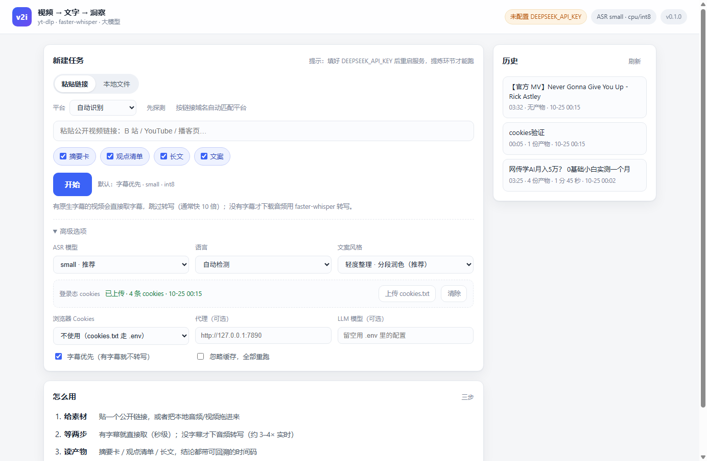

> 上传时会校验格式：必须是浏览器扩展导出的 Netscape 格式（`# Netscape HTTP Cookie File` + 7 列制表符分隔），JSON 导出会被拒绝并提示。

> 注意：yt-dlp 会把站点下发的新 cookie 回写到这个文件里，所以它会随着使用变长——这是正常现象。

> ⚠️ 新版 Chrome / Edge（v127+）的 cookie 有 App-Bound 加密，yt-dlp 可能解不开，会报 `Failed to decrypt with DPAPI`；这时请用扩展导出 `cookies.txt`，或改用 Firefox。Chrome 正在运行时也会报 `Could not copy Chrome cookie database`，先关掉浏览器再试。

**国内访问 YouTube / X / TikTok** 需要代理：`.env` 里 `V2I_PROXY=http://127.0.0.1:7890`，或 GUI 高级选项「代理」直接填。

**探测失败不用自己猜**：报错后面直接跟一个可点的动作按钮，点一下就会展开高级选项并定位到对应输入框。

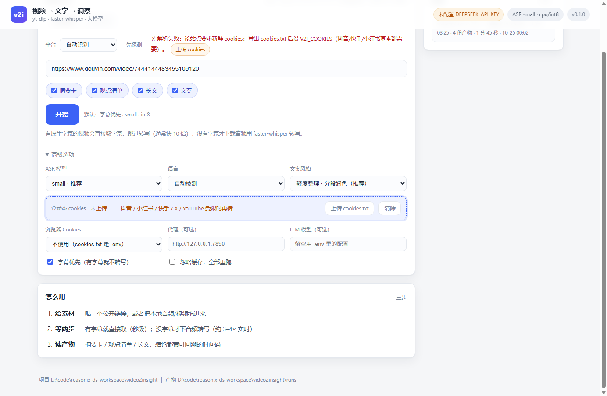

| 报错类型 | 按钮 | 点了之后 |
|---|---|---|
| 需要 cookies / 触发 bot 校验 | `上传 cookies` | 展开高级选项、高亮 cookies 行、弹出文件选择 |
| Chrome 占用 cookie 库 | `改用 cookies.txt` | 同上（并提示先关浏览器） |
| 网络超时 / 打不开网页 | `去填代理` | 展开高级选项并聚焦代理输入框 |
| 链接形式不支持（如抖音 `/shipin/`） | `支持哪种链接？` | 就地显示该平台支持的链接形式 |

命令行也能先探一下，避免白跑：

```powershell
.\v2i.cmd probe "<url>"                          # 标题/时长/字幕/格式
.\v2i.cmd probe "<url>" --cookies-from-browser edge
.\v2i.cmd run "<url>" --platform douyin --cookies-from-browser chrome
```
## 产物

```
runs/<标题>-<id>/
  meta.json          视频元数据
  source.json        取词方式（字幕 / 音频 / 视频）
  source.mp4         仅勾选「保留原视频」时存在（可播放、可下载）
  transcript.json    唯一真源：段级文本 + 时间戳
  transcript.srt     字幕文件
  transcript.md      带时间码的逐字稿
  chunks.json        分块结果（带 [mm:ss] 锚点）
  notes/chunk-*.json 每块的 map 产物（可单独重跑）
  out/summary.md     摘要卡
  out/points.md      观点清单
  out/article.md     长文
  out/digest.json    全部结构化笔记
  manifest.json      耗时、模型、token 用量、失效引用
```

## 设计要点

- **字幕优先**：有原生字幕（vtt/json3/srt）就直接取，跳过下载与转写。B 站的 `danmaku` 是弹幕，不算字幕，已排除。
- **transcript.json 是唯一真源**：换 prompt、换模型、换输出形态都只重跑提炼，不再碰音频。
- **map-reduce**：按 ~1600 字分块，每块先出带时间码的结构化笔记，再归并；2 小时播客也不会撑爆上下文。
- **引用可核查**：所有结论要求带 `[mm:ss]`，程序校验每个时间码是否落在某分块的时间范围内，失效的写进 `manifest.json` 的 `invalid_citations`。
- **VAD 有兜底**：Silero VAD 会把纯音乐/演唱判成"无人声"，此时自动关掉 VAD 重跑一遍（日志会提示）。
- **缓存**：每阶段独立缓存，`--force` 才重跑；断网/429 不丢已有产物。
- **长链接不撑破版面**：渲染时把分享链接上的跟踪参数（B 站那种能长到 800+ 字符）裁成 `scheme://host/path`，并对 URL / 文件路径做任意位置换行；`v2i render` 会把旧产物的逐字稿一并重写，不用重跑转写。

## 实测（本机，CPU-only）

| 项 | 数据 |
|---|---|
| 硬件 | 无 NVIDIA GPU，Python 3.14.6，CPU int8 |
| 模型 | faster-whisper `small` |
| 3 分 32 秒视频 | 转写 59s（**3.6× 实时**），全流程 62s |
| 输出 | 64 段逐字稿 / 自动分块（尾块<35% 会并进上一块）/ 3 份 Markdown |

> `medium` 约慢 2.5–3 倍，`large-v3` 在纯 CPU 上不建议。

## 常见问题

| 现象 | 处理 |
|---|---|
| `No module named 'av'` / `metadata_errors` | `av` 版本太新，装 `av==16.1.0` |
| 模型下载报 `CAS Client Error 401` | 镜像站不支持 Xet 协议；已内置 `HF_HUB_DISABLE_XET=1`，若自定义 endpoint 需保留该变量 |
| `Could not find a version that satisfies ...`（清华源） | 换阿里云源：`-i https://mirrors.aliyun.com/pypi/simple` |
| 下载音频 0% 卡住 | pypi 文件被限速；这是下载站点问题，换网络/VPN，或对 YouTube 用 cookies |
| YouTube 报 403 / bot 检测 | 导出 cookies.txt 设 `V2I_COOKIES`，或装 `bgutil-ytdlp-pot-provider` |
| B 站高清晰度失败 | 需要登录 cookie（`V2I_COOKIES`），字幕/音频通常不需要 |
| `缺少 DEEPSEEK_API_KEY` | 写进项目 `.env`，或 `--provider ollama` 走本地模型 |
| 转写结果为空 | 试 `--language zh`；纯音乐场景会自动关 VAD 重试 |
| 想换模型 | `--provider` / `--model`，或 `.env` 里 `V2I_PROVIDER` / `V2I_MODEL` |
| 没配 key 会怎样 | 转写照常跑完并保留 `transcript.md` / `.srt`，只跳过提炼并在日志里说明——不白烧算力 |
| 端口 8765 被占用 | 已经开着一个实例；直接访问它，或 `v2i web --port 8899` |
| 上传大文件失败 | 上限 4GB；确认后缀在支持列表里（mp4/mkv/mov/webm/mp3/m4a/wav/flac/aac/ogg/opus/wma/amr） |

## 目录

```
start.cmd       # 一键启动：装依赖 -> 起服务 -> 开浏览器
v2i.cmd         # 启动器：无参数=开 GUI，带参数=CLI
v2i/            # 包本体（cli / web / fetch / asr / normalize / llm / distill / render / prompts）
  static/       # Web GUI：index.html + app.css + app.js（零依赖）
tools/          # 开发工具：selftest.py（离线自检）、mock_llm.py（无 key 时验证提炼链路）
docs/           # 界面截图
vendor/         # 依赖（pip --target 装进来，git 忽略）
runs/           # 每次运行的产物（git 忽略）
  _uploads/     # GUI 上传的原始文件（以 _ 开头，不出现在历史里）
```
=======
# AI-video-gen
视频 → 文字 → 洞察 | ytd-lp faster-whisper
>>>>>>> 7f359d1c3a6d07c356094b55b8c529cc16b05fc9
