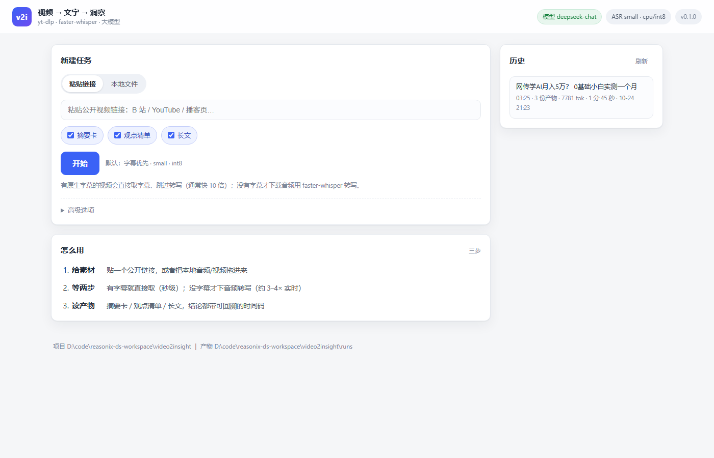
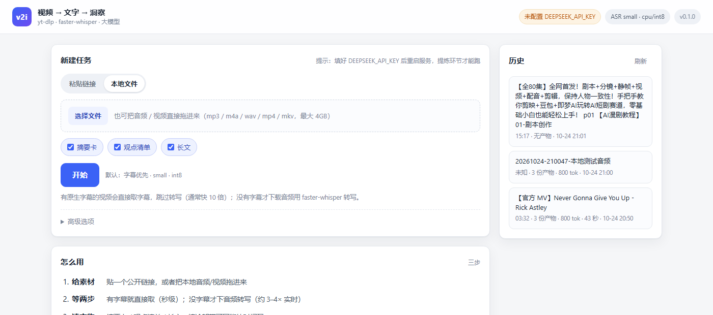
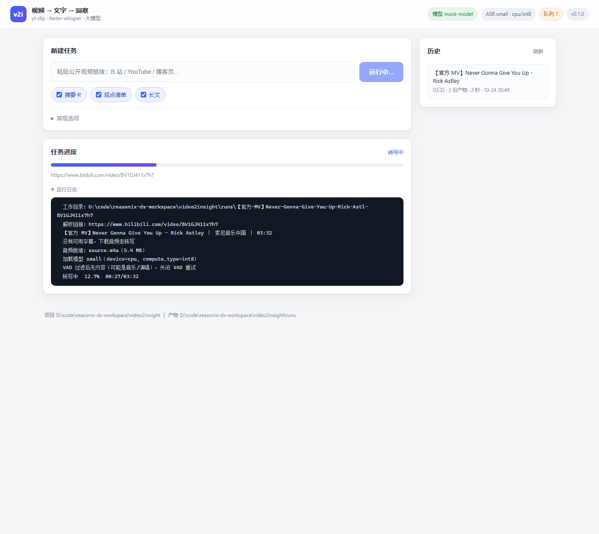
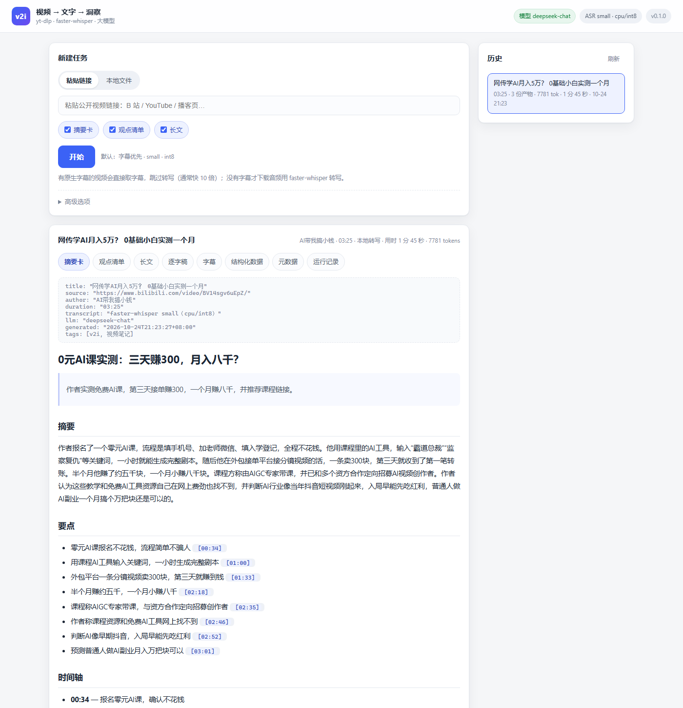

<<<<<<< HEAD
# v2i · 视频 → 文字 → 洞察

一条命令把公开视频变成三份 Markdown：**摘要卡**、**观点清单**、**可发布长文**。  
链路：`yt-dlp`（取字幕/音频）→ `faster-whisper`（CPU 转写）→ 大模型（map-reduce 提炼）。

```
URL ──► fetch（字幕优先） ──► transcribe（无字幕才跑） ──► normalize（分块+时间锚点）
                                                              │
                                     ┌────────────────────────┘
                                     ▼
                     map：每块 → 结构化笔记（要点/论据/引用/时间码）
                                     ▼
                     reduce：摘要卡 ｜ 观点清单 ｜ 长文
                                     ▼
                runs/<标题>-<id>/out/{summary,points,article}.md
```

## 安装（Windows，无需 GPU）

依赖装在项目内的 `vendor/`，不污染全局 Python。**镜像用阿里云**（清华源在本机 pip 26 上解析不到包，直接连 pypi 会被限速到 30KB/s）：

```powershell
$root = "D:\code\reasonix-ds-workspace\video2insight"
python -m pip install --target "$root\vendor" --upgrade `
  yt-dlp faster-whisper "av==16.1.0" requests imageio-ffmpeg `
  -i https://mirrors.aliyun.com/pypi/simple
```

> `av` 必须 < 19：av 19 去掉了 `metadata_errors` 参数，faster-whisper 1.2.1 会直接报 `TypeError`。

配置 key：

```powershell
notepad "$root\.env"     # 填 DEEPSEEK_API_KEY=sk-...
```

自检：

```powershell
cd $root
.\v2i.cmd doctor          # 依赖 / ffmpeg / CUDA / 运行目录 / key
.\v2i.cmd doctor --ping   # 顺带调一次大模型，验证 key 与网络
python tools\selftest.py  # 离线自检：字幕解析 / 分块 / JSON 抽取 / 引用校验
```

> 不用 `v2i.cmd` 时：`$env:PYTHONPATH="$root\vendor;$root"`，然后 `python -m v2i ...`。

## 用法

```powershell
# 全流程（默认产出 summary + points + article）
.\v2i.cmd run "https://www.bilibili.com/video/BV1GJ411x7h7"

# 只要摘要和观点
.\v2i.cmd run "<url>" --mode summary,points

# 有字幕也不用，强制转写（想要更高精度的中文）
.\v2i.cmd run "<url>" --no-subs --asr-model medium

# 批量
.\v2i.cmd batch urls.txt --mode all

# 只重跑提炼（换 prompt / 换模型，不重新转写）
.\v2i.cmd distill runs\<dir> --force

# 只重渲染 Markdown（改排版/改 frontmatter，不调用大模型、不花钱）
.\v2i.cmd render runs\<dir>

# 本地文件转写
.\v2i.cmd transcribe "D:\path\to\audio.mp3" --language zh
```

## 一键启动

**双击 `start.cmd`** 就行：缺依赖会自动装（阿里云源）、缺 `.env` 会自动建、起服务后自动开浏览器。

```
start.cmd          # 首次运行装依赖，之后直接开界面
v2i.cmd            # 不带参数双击 = 同一个效果；带参数 = 当 CLI 用
```

> 首次启动要下 250MB 依赖 + 之后首次转写要下 460MB 模型（`small`），都属于一次性成本。

## Web GUI（本地网页）

不想敲命令就用它，页面和 CLI 走的是同一条流水线：

```powershell
.\v2i.cmd web                          # 默认 http://127.0.0.1:8765，自动开浏览器
.\v2i.cmd web --port 8899 --no-browser
```



能做的事：

- **两种素材来源**：贴链接（B 站 / YouTube / 播客页），或**把本地音频/视频拖进来**（mp3 / m4a / wav / mp4 / mkv …，最大 4GB）。
- **默认就开箱可用**：字幕优先 + `small` 模型，勾选要哪几份产物（摘要卡 / 观点清单 / 长文）直接开始；高级选项里可换模型、语言、强制重跑。
- **实时进度**：阶段（解析 → 下载 → 转写 → 提炼）、进度条、逐行日志（含 VAD 回退、转写百分比）。
- **产物阅读**：摘要 / 观点 / 长文 / 逐字稿 / 字幕 / 结构化 JSON / 元数据，Markdown 渲染带时间码高亮。
- **历史**：左侧列出所有跑过的任务，点开即看；引用校验有问题的任务会标 `N 处引用待核`。
- **断线重连**：刷新页面会自动接上还在跑的任务；地址栏 `#run=<目录名>` 可直达某次结果。







> 截图里的文案是接 mock 模型跑出来的（为了先验证链路），换成真实 key 后就是正常内容；界面、时间码、渲染是真的。

实现上刻意做得很薄：标准库 `http.server` + 原生 JS，没有 Flask、没有 npm、不加载任何 CDN；任务串行执行（单 worker），因为 ASR 本来就吃满 CPU，并发只会互相拖慢。只监听 `127.0.0.1`，不对外网暴露。

> 页面右上角绿色=已配好 LLM key，橙色=没配。没配 key 时**转写照常跑完并保留**（`transcript.md` / `.srt` 都在），只是提炼会跳过并在日志里说明原因——不会白跑一遍算力。

## 产物

```
runs/<标题>-<id>/
  meta.json          视频元数据
  source.json        取词方式（字幕 / 音频）
  transcript.json    唯一真源：段级文本 + 时间戳
  transcript.srt     字幕文件
  transcript.md      带时间码的逐字稿
  chunks.json        分块结果（带 [mm:ss] 锚点）
  notes/chunk-*.json 每块的 map 产物（可单独重跑）
  out/summary.md     摘要卡
  out/points.md      观点清单
  out/article.md     长文
  out/digest.json    全部结构化笔记
  manifest.json      耗时、模型、token 用量、失效引用
```

## 设计要点

- **字幕优先**：有原生字幕（vtt/json3/srt）就直接取，跳过下载与转写。B 站的 `danmaku` 是弹幕，不算字幕，已排除。
- **transcript.json 是唯一真源**：换 prompt、换模型、换输出形态都只重跑提炼，不再碰音频。
- **map-reduce**：按 ~1600 字分块，每块先出带时间码的结构化笔记，再归并；2 小时播客也不会撑爆上下文。
- **引用可核查**：所有结论要求带 `[mm:ss]`，程序校验每个时间码是否落在某分块的时间范围内，失效的写进 `manifest.json` 的 `invalid_citations`。
- **VAD 有兜底**：Silero VAD 会把纯音乐/演唱判成"无人声"，此时自动关掉 VAD 重跑一遍（日志会提示）。
- **缓存**：每阶段独立缓存，`--force` 才重跑；断网/429 不丢已有产物。

## 实测（本机，CPU-only）

| 项 | 数据 |
|---|---|
| 硬件 | 无 NVIDIA GPU，Python 3.14.6，CPU int8 |
| 模型 | faster-whisper `small` |
| 3 分 32 秒视频 | 转写 59s（**3.6× 实时**），全流程 62s |
| 输出 | 64 段逐字稿 / 自动分块（尾块<35% 会并进上一块）/ 3 份 Markdown |

> `medium` 约慢 2.5–3 倍，`large-v3` 在纯 CPU 上不建议。

## 常见问题

| 现象 | 处理 |
|---|---|
| `No module named 'av'` / `metadata_errors` | `av` 版本太新，装 `av==16.1.0` |
| 模型下载报 `CAS Client Error 401` | 镜像站不支持 Xet 协议；已内置 `HF_HUB_DISABLE_XET=1`，若自定义 endpoint 需保留该变量 |
| `Could not find a version that satisfies ...`（清华源） | 换阿里云源：`-i https://mirrors.aliyun.com/pypi/simple` |
| 下载音频 0% 卡住 | pypi 文件被限速；这是下载站点问题，换网络/VPN，或对 YouTube 用 cookies |
| YouTube 报 403 / bot 检测 | 导出 cookies.txt 设 `V2I_COOKIES`，或装 `bgutil-ytdlp-pot-provider` |
| B 站高清晰度失败 | 需要登录 cookie（`V2I_COOKIES`），字幕/音频通常不需要 |
| `缺少 DEEPSEEK_API_KEY` | 写进项目 `.env`，或 `--provider ollama` 走本地模型 |
| 转写结果为空 | 试 `--language zh`；纯音乐场景会自动关 VAD 重试 |
| 想换模型 | `--provider` / `--model`，或 `.env` 里 `V2I_PROVIDER` / `V2I_MODEL` |
| 没配 key 会怎样 | 转写照常跑完并保留 `transcript.md` / `.srt`，只跳过提炼并在日志里说明——不白烧算力 |
| 端口 8765 被占用 | 已经开着一个实例；直接访问它，或 `v2i web --port 8899` |
| 上传大文件失败 | 上限 4GB；确认后缀在支持列表里（mp4/mkv/mov/webm/mp3/m4a/wav/flac/aac/ogg/opus/wma/amr） |

## 目录

```
start.cmd       # 一键启动：装依赖 -> 起服务 -> 开浏览器
v2i.cmd         # 启动器：无参数=开 GUI，带参数=CLI
v2i/            # 包本体（cli / web / fetch / asr / normalize / llm / distill / render / prompts）
  static/       # Web GUI：index.html + app.css + app.js（零依赖）
tools/          # 开发工具：selftest.py（离线自检）、mock_llm.py（无 key 时验证提炼链路）
docs/           # 界面截图
vendor/         # 依赖（pip --target 装进来，git 忽略）
runs/           # 每次运行的产物（git 忽略）
  _uploads/     # GUI 上传的原始文件（以 _ 开头，不出现在历史里）
```
=======
# AI-video-gen
视频 → 文字 → 洞察 | ytd-lp faster-whisper
>>>>>>> 7f359d1c3a6d07c356094b55b8c529cc16b05fc9
